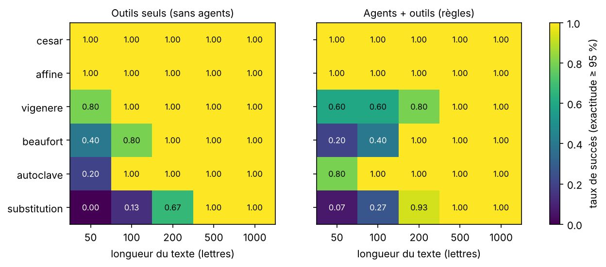
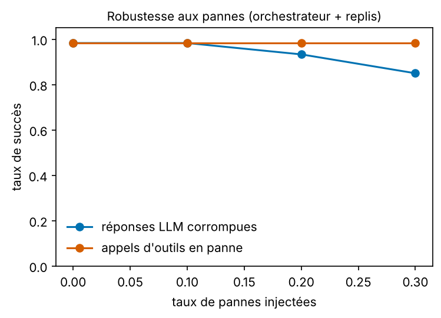
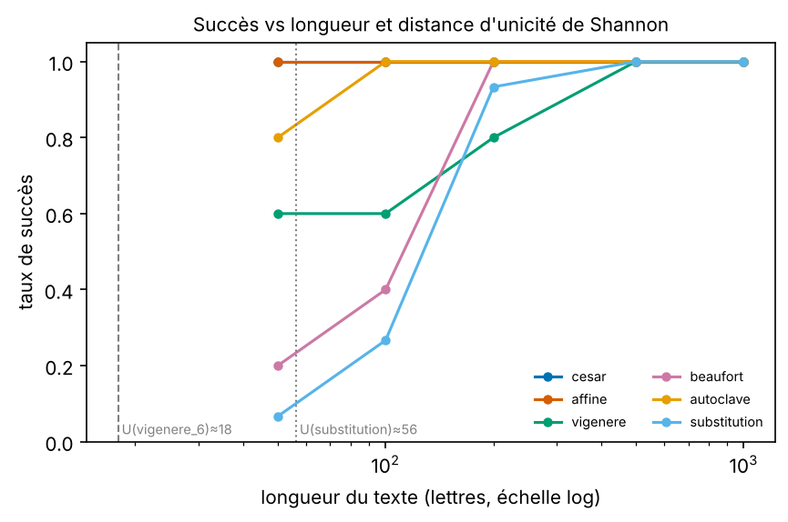

# Résumé / Abstract

**FR.** Vigenère-Squad est un système multi-agents qui identifie et casse six chiffrements classiques (César, affine, Vigenère, Beaufort, autoclave, substitution) sur du texte français.
Quatre agents (Classifieur, Cryptanalyste, Linguiste, Pédagogue) pilotés par un orchestrateur explicite appellent des outils déterministes ; le LLM décide et explique, le code calcule.
Sur 150 textes × 3 répétitions, les agents à règles (sans LLM) retrouvent le texte dans 85.6 % des cas, contre 86.7 % pour la baseline sans agents ;
les textes de 500 lettres ou plus sont tous cassés. Les agents n'améliorent pas la précision ; ils apportent traçabilité, explication et tolérance aux pannes.

**EN.** Vigenère-Squad is a multi-agent system that identifies and breaks six classical ciphers on French text. Four agents (Classifier, Cryptanalyst, Linguist, Teacher) coordinated by an explicit orchestrator call deterministic tools; the LLM decides and explains, the code computes. On 150 texts × 3 repetitions the rule-based agents recover 85.6 % of the plaintexts versus 86.7 % for a no-agent baseline; all texts of 500+ letters are broken. Agents do not improve accuracy; they add traceability, explanation and fault tolerance.

# 1. Problème et motivation

Casser un chiffrement classique est une suite de décisions : de quel chiffrement s'agit-il, quelle attaque tenter, le résultat est-il du français, comment l'expliquer ? Les calculs sont mécaniques, le choix de la stratégie l'est moins.
C'est le terrain naturel d'un système d'agents, à condition de ne pas confier au LLM ce qu'un programme fait exactement : compter des lettres, tester 312 clés affines, optimiser une permutation.

# 2. Architecture

Quatre agents à rôles disjoints, un orchestrateur Python explicite (`orchestrator.py`) et un état partagé typé (`EtatPartage`) :

1. **Classifieur** — outils : `indice_coincidence`, `frequences`, `kasiski`. Sortie : famille et ordre des hypothèses.
2. **Cryptanalyste** — outils d'attaque (`chi2_cesar`, `force_brute_affine`, `attaque_vigenere`, `attaque_autoclave`, `attaque_substitution`) et d'analyse (`kasiski`, `friedman`, `ic_colonnes`).
3. **Linguiste** — outil : `score_quadrigrammes` (vraisemblance française et seuil). Valide ou rejette le candidat.
4. **Pédagogue** — outil : `generer_exercice`. Rédige l'explication et propose un exercice vérifiable par le code.

**Boucle de vérification.** Si le Linguiste rejette le texte candidat, l'orchestrateur passe à l'hypothèse suivante (6 tentatives au plus). Le verdict final est celui du code (seuil) : un désaccord LLM/code est compté et tracé.
**Listes d'outils fermées.** Un outil hors liste, ou des arguments hors bornes, sont refusés avant exécution. **Trace.** Chaque message LLM, appel d'outil, refus, panne et décision est écrit en JSONL.
**Le LLM ne recopie jamais le texte** : les outils reçoivent le chiffré ou le candidat par liaison côté code, et le LLM ne voit que des statistiques et un aperçu.

# 3. Outils

- **Indice de coïncidence** $IC=\sum n_i(n_i-1)/N(N-1)$ : ≈ 0,078 en français monoalphabétique, ≈ 0,038 pour un texte aléatoire.
- **Kasiski** : les distances entre répétitions de trigrammes sont des multiples de la longueur de clé ; vote des diviseurs.
- **Friedman** : $L\approx (k_p-k_r)N/((N-1)IC-k_rN+k_p)$ avec $k_p=0{,}0778$, $k_r=1/26$.
- **Chi²** sur les fréquences du français : décalage de César, et par colonne pour Vigenère. **Beaufort** se ramène à Vigenère par la symétrie $25-C$.
- **Autoclave** : Kasiski échoue (le flux de clé contient le clair) ; ascension de colline sur le mot-clé, scorée par quadrigrammes.
- **Substitution** : recuit simulé / ascension de colline sur une permutation, avec 6 redémarrages, scorée par un modèle de langue 1–4-grammes interpolé (table 26⁴ en log₁₀).

# 4. Protocole expérimental

Corpus généré avec la graine 42 (SHA-256 `b5b1280ccafdb132…`) : 6 chiffrements × 5 longueurs × 5 textes. Les textes clairs sont tirés d'un fichier de test que le modèle de langue n'a jamais vu.
Chaque mesure est répétée 3 fois (graines 42–44). Succès : au moins 95 % de lettres exactes. Comparaisons : (a) outils seuls ; (b) agents à règles sans LLM ; (c)–(d) deux LLM locaux.
Tous les paramètres sont dans `config/experiment.yaml` ; l'environnement (versions, matériel, digest des modèles, hachages des prompts) dans `results/ENVIRONMENT.json`.
Environnement de cette exécution : Python 3.13.18, Linux-6.18.44-fc-v338-x86_64-with-glibc2.39, 2 CPU, durée 270.9 s, pic mémoire 62.8 Mo.

# 5. Résultats

## 5.1 Baseline : outils seuls

| chiffrement | 50 | 100 | 200 | 500 | 1000 | global |
|---|---|---|---|---|---|---|
| affine | 100.0 % | 100.0 % | 100.0 % | 100.0 % | 100.0 % | 100.0 % |
| autoclave | 20.0 % | 100.0 % | 100.0 % | 100.0 % | 100.0 % | 84.0 % |
| beaufort | 40.0 % | 80.0 % | 100.0 % | 100.0 % | 100.0 % | 84.0 % |
| cesar | 100.0 % | 100.0 % | 100.0 % | 100.0 % | 100.0 % | 100.0 % |
| substitution | 0.0 % | 13.3 % | 66.7 % | 100.0 % | 100.0 % | 56.0 % |
| vigenere | 80.0 % | 100.0 % | 100.0 % | 100.0 % | 100.0 % | 96.0 % |
| **toutes** | 56.7 % | 82.2 % | 94.4 % | 100.0 % | 100.0 % | **86.7 %** |

(σ entre répétitions : 0.0094.)

## 5.2 Agents + outils (politique à règles, sans LLM)

| chiffrement | 50 | 100 | 200 | 500 | 1000 | global |
|---|---|---|---|---|---|---|
| affine | 100.0 % | 100.0 % | 100.0 % | 100.0 % | 100.0 % | 100.0 % |
| autoclave | 80.0 % | 100.0 % | 100.0 % | 100.0 % | 100.0 % | 96.0 % |
| beaufort | 20.0 % | 40.0 % | 100.0 % | 100.0 % | 100.0 % | 72.0 % |
| cesar | 100.0 % | 100.0 % | 100.0 % | 100.0 % | 100.0 % | 100.0 % |
| substitution | 6.7 % | 26.7 % | 93.3 % | 100.0 % | 100.0 % | 65.3 % |
| vigenere | 60.0 % | 60.0 % | 80.0 % | 100.0 % | 100.0 % | 80.0 % |
| **toutes** | 61.1 % | 71.1 % | 95.6 % | 100.0 % | 100.0 % | **85.6 %** |

(σ entre répétitions : 0.0031 ; 2.0533 hypothèses testées en moyenne ; 16.28 messages agent par texte ; 0.1589 s par texte.)

**Lecture.** Au-delà de 500 lettres tout est cassé. Les chiffrements monoalphabétiques simples le sont dès 50 lettres. La substitution demande environ 200 lettres ou plus, ce qui est cohérent avec la distance d'unicité (§5.5).
Les agents à règles font **moins bien** que la baseline sur Vigenère et Beaufort courts : choisir la longueur de clé par Kasiski + IC des colonnes est moins fiable que tester les longueurs 2–12 et garder le meilleur score.

## 5.3 Avec LLM local

**Mesures LLM non exécutées dans cette version** (`option --llm absente`). Elles sont produites par `make reproduce` et remplissent cette section.

## 5.4 Robustesse et pannes

- 5 % de lettres du chiffré remplacées : succès 48.7 %.
- Clair anglais (le Linguiste est entraîné sur le français) : succès 55.6 %.

| taux de pannes | succès (LLM corrompu) | repli moyen | succès (outils en panne) |
|---|---|---|---|
| 0.0 | 98.3 % | 0.0 | 98.3 % |
| 0.1 | 98.3 % | 0.0333 | 98.3 % |
| 0.2 | 93.3 % | 0.25 | 98.3 % |
| 0.3 | 85.0 % | 0.85 | 98.3 % |

{width=60%}

Les pannes d'outils sont absorbées par de nouvelles tentatives dans l'agent. Les réponses LLM corrompues (JSON invalide, action inconnue, vide) déclenchent un rejet de schéma puis, au-delà de 3 erreurs, un repli de l'orchestrateur.

## 5.5 Kasiski contre l'autoclave et distance d'unicité

La vraie longueur de clé figure dans le top 3 de Kasiski pour 100.0 % des Vigenère (n=20) contre 65.0 % des autoclaves (n=20) : l'autoclave brouille Kasiski.
Le modèle de langue donne une entropie de 3.127 bits/lettre (borne haute), soit une redondance de 1.573 bits/lettre et des distances d'unicité $U=H(K)/D$ de 3.0 lettres (César), 5.3 (affine), 17.9 (Vigenère, clé de 6) et 56.2 (substitution) : ordres de grandeur, car l'entropie est surestimée sur un petit corpus.
Le succès réel exige davantage de lettres que $U$ : l'unicité est une condition nécessaire, pas suffisante, pour un attaquant au calcul borné.

{width=75%}

Le Pédagogue produit des exercices valides dans 100.0 % des cas (n=60, vérifiés par déchiffrement avec la clé du corrigé).

# 6. Discussion et limites

- **Résultat négatif assumé** : les agents ne battent pas la baseline en précision. Leur valeur : modularité, trace complète, explications, tolérance aux pannes, listes d'outils fermées.
- **Corpus d'entraînement minuscule** (≈ 6,7 ko) : modèle de langue pauvre, entropie surestimée, textes de test qui se recouvrent aux grandes longueurs.
- **Linguiste** : le seuil accepte parfois un clair en partie faux ; il suppose le français.
- **LLM** : évalués sur un sous-ensemble (12 textes × 3 répétitions × 2 modèles) pour tenir sur un portable sans GPU.
- Pas de comparaison avec un LLM seul sans outils (hors périmètre) ; les LLM de ≤ 8 Go calculent mal des fréquences, ce qui justifie la répartition « LLM décide / code calcule ».

# 7. Sécurité

Modèle de menaces STRIDE dans `docs/THREAT_MODEL.md` : injection via le texte chiffré (le texte n'entre pas dans le prompt), clair inventé par le LLM (le code a le dernier mot), boucle infinie (bornes de pas et d'essais), élévation de privilèges (listes blanches, aucun outil shell/fichier/réseau), fuite de données (réseau local uniquement, gitleaks en CI).

# 8. Reproductibilité

`make reproduce` rejoue tout (tests, corpus, baseline, agents, LLM, métriques, figures, site). `make reproduce-small` (CI) utilise `qwen3:0.6b`. Environnement figé par `uv.lock` et `Dockerfile` ; `SHA256SUMS` signé ; archive Zenodo de la release `v1.0.0`.

# 9. Usage de l'IA

Voir `AI_USAGE.md` : conception et code réalisés avec l'assistance de Claude (Anthropic), sous la direction et la relecture de l'auteur ; résultats issus uniquement de l'exécution du dépôt.

# Références

- Kasiski, F. W. (1863). *Die Geheimschriften und die Dechiffrir-Kunst*.
- Friedman, W. F. (1922). *The Index of Coincidence and Its Applications in Cryptography*.
- Shannon, C. E. (1949). Communication theory of secrecy systems. *Bell System Technical Journal*, 28(4).
- Kirkpatrick, S., Gelatt, C. D., Vecchi, M. P. (1983). Optimization by simulated annealing. *Science*, 220.
